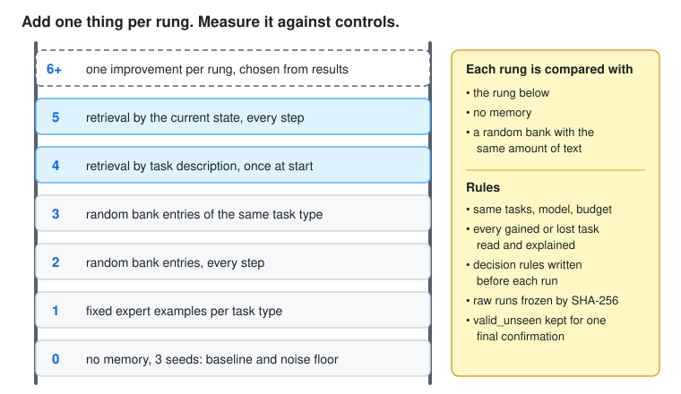

# adaptive-agent-memory-research

**Experience memory for LLM agents that act — built up from the simplest thing that works, one measured step at a time, with controls at every step.**

[](https://github.com/krapcys1-maker/adaptive-agent-memory-research/actions/workflows/ci.yml)
[](LICENSE)
[](LICENSES/CC-BY-4.0.txt)
[](docs/research-map/VOLUNTEER_COMPUTE.md)
[](https://github.com/krapcys1-maker/adaptive-agent-memory-research/labels/good%20first%20issue)

An agent that does tasks (in a home simulator, a science lab simulator, later with real tools) should get better from its own experience without retraining the model. This project asks a narrow question first and earns every next step with a measurement:

> Does showing an agent the *right* pieces of its earlier successful runs, at the *right* moment, make it solve more tasks — and is it the match that helps, or just showing any example?

<!-- aamr-findings:start (generated by the lab's code from the published packages in data/lab/autolab-*; manual edits here are replaced on the next update) -->
## Current findings

The latest published lab result is **[ALFWORLD-LADDER-R4-V6](data/lab/autolab-alfworld-ladder-r4-v6/README.md)** (n = 300 units).
Its question: With retrieval held fixed (the same two goal-similar expert walkthroughs), does the 4B agent's solve rate on fresh held-out train games rise above a token-matched placebo block when the walkthroughs are shown in full (V5B replication), as their actions only, or as an abstract subgoal plan without numbers and room-specific locations?

| comparison (primary) | difference | 95% interval | gains / losses | state | direction status |
|---|---|---|---|---|---|
| [`retrieved_steps` − `placebo`](data/lab/autolab-alfworld-ladder-r4-v6/README.md) | +0.137 | [+0.055, +0.219] | 75 / 34 | positive | open |
| [`retrieved_plan` − `placebo`](data/lab/autolab-alfworld-ladder-r4-v6/README.md) | +0.130 | [+0.060, +0.200] | 60 / 21 | positive | measurement_problem |
| [`retrieved_task` − `placebo`](data/lab/autolab-alfworld-ladder-r4-v6/README.md) | +0.130 | [+0.049, +0.211] | 72 / 33 | positive | open |

The package marks these directions as not valid evidence yet (`retrieved_plan`: measurement problem flagged); read its caveats before using the numbers.

### Every published lab program

| program | units | primary comparison | difference | 95% interval | state | direction status | read before citing |
|---|---|---|---|---|---|---|---|
| [ALFWORLD-LADDER-R4-V6](data/lab/autolab-alfworld-ladder-r4-v6/README.md) | 300 | `retrieved_steps` − `placebo` | +0.137 | [+0.055, +0.219] | positive | open | [caveats (5)](data/lab/autolab-alfworld-ladder-r4-v6/README.md#caveats), [erratum](docs/11-research-laboratory/errata/2026-11-23-alfworld-ladder-r4-v6-seed1-and-d8-addendum.md) |
| [ALFWORLD-LADDER-R4-V6](data/lab/autolab-alfworld-ladder-r4-v6/README.md) | 300 | `retrieved_plan` − `placebo` | +0.130 | [+0.060, +0.200] | positive | measurement_problem | [caveats (5)](data/lab/autolab-alfworld-ladder-r4-v6/README.md#caveats), [erratum](docs/11-research-laboratory/errata/2026-11-23-alfworld-ladder-r4-v6-seed1-and-d8-addendum.md) |
| [ALFWORLD-LADDER-R4-V6](data/lab/autolab-alfworld-ladder-r4-v6/README.md) | 300 | `retrieved_task` − `placebo` | +0.130 | [+0.049, +0.211] | positive | open | [caveats (5)](data/lab/autolab-alfworld-ladder-r4-v6/README.md#caveats), [erratum](docs/11-research-laboratory/errata/2026-11-23-alfworld-ladder-r4-v6-seed1-and-d8-addendum.md) |
| [ALFWORLD-LADDER-R4-V5B](data/lab/autolab-alfworld-ladder-r4-v5b/README.md) | 201 | `retrieved_task` − `placebo` | +0.169 | [+0.053, +0.285] | positive | open | [caveats (5)](data/lab/autolab-alfworld-ladder-r4-v5b/README.md#caveats), [erratum](docs/11-research-laboratory/errata/2026-11-19-alfworld-ladder-r4-v5b-secondary-contrast.md), [erratum](docs/11-research-laboratory/errata/2026-11-23-alfworld-ladder-r4-v5b-seed1-addendum.md) |
| [ALFWORLD-LADDER-R4-V5B](data/lab/autolab-alfworld-ladder-r4-v5b/README.md) | 201 | `mismatched_type` − `placebo` | +0.015 | [-0.067, +0.097] | equivalent | closed | [caveats (5)](data/lab/autolab-alfworld-ladder-r4-v5b/README.md#caveats), [erratum](docs/11-research-laboratory/errata/2026-11-19-alfworld-ladder-r4-v5b-secondary-contrast.md), [erratum](docs/11-research-laboratory/errata/2026-11-23-alfworld-ladder-r4-v5b-seed1-addendum.md) |
| [ALFWORLD-LADDER-R4-V4](data/lab/autolab-alfworld-ladder-r4-v4/README.md) | 300 | `retrieved_task` − `placebo` | +0.240 | [+0.177, +0.303] | practical | measurement_problem | [caveats (3)](data/lab/autolab-alfworld-ladder-r4-v4/README.md#caveats), [erratum](docs/11-research-laboratory/errata/2026-11-19-alfworld-ladder-r4-v4-h3-verdict.md) |
| [ALFWORLD-LADDER-R4-V3](data/lab/autolab-alfworld-ladder-r4-v3/README.md) | 100 | `retrieved_task` − `placebo` | +0.070 | [-0.042, +0.182] | inconclusive | measurement_problem | [caveats (2)](data/lab/autolab-alfworld-ladder-r4-v3/README.md#caveats) |

### The control itself: placebo against no memory

| program | placebo − none | 95% interval | state |
|---|---|---|---|
| [ALFWORLD-LADDER-R4-V6](data/lab/autolab-alfworld-ladder-r4-v6/README.md) | -0.057 | [-0.122, +0.009] | inconclusive |
| [ALFWORLD-LADDER-R4-V5B](data/lab/autolab-alfworld-ladder-r4-v5b/README.md) | -0.060 | [-0.157, +0.037] | inconclusive |
| [ALFWORLD-LADDER-R4-V4](data/lab/autolab-alfworld-ladder-r4-v4/README.md) | -0.023 | [-0.071, +0.024] | equivalent |
| [ALFWORLD-LADDER-R4-V3](data/lab/autolab-alfworld-ladder-r4-v3/README.md) | +0.130 | [+0.040, +0.220] | positive |

Every number above is copied by code from the results table of the package README it links to. The primary comparisons are also cross-checked against the package's `knowledge.jsonl`, both files' SHA-256 against `PUBLISHED_FILES.json`, and the whole package against the digest the maintainer approved for publication. Each package lists its caveats and the scope of its conclusions; a result applies only to that program's tasks, model and scale. Recompute the numbers yourself with `python scripts/verify_autolab_packages.py`.

Related: [the preregistered placebo study K1](data/lab/aamr-k1/README.md); [the placebo check you can run on your own model](docs/challenges/placebo-check.md); [the public results table of the challenges](docs/challenges/RESULTS.md).

<sub>Updated 2026-11-21 from `main` at 8a5f61f.</sub>
<!-- aamr-findings:end -->

## Help in five minutes

| You have | Do this |
|---|---|
| 5 minutes, no install | Open the [per-task table](data/lab/autolab-alfworld-ladder-r4-v3/per_unit.csv) of the published run next to its [README](data/lab/autolab-alfworld-ladder-r4-v3/README.md). `python scripts/verify_autolab_packages.py` recomputes the published numbers from the package alone ([what it checks](REPRODUCE.md#the-autolab-result-packages-recompute-the-published-numbers-from-the-package-alone)). If a number, a link or a claim does not hold up, open an issue — a reported problem in a published result is a real contribution. |
| A laptop | Clone and run the full local check (below). If it fails on your machine, that is a defect worth reporting. |
| An evening, no GPU | Pick an issue labelled [`good first issue`](https://github.com/krapcys1-maker/adaptive-agent-memory-research/labels/good%20first%20issue) or [`no-gpu-needed`](https://github.com/krapcys1-maker/adaptive-agent-memory-research/labels/no-gpu-needed): analysis, tests, docs, paper summaries. |
| A GPU with about 12 GB | Run a cell (about 2 hours) or the [placebo check](docs/challenges/placebo-check.md): see [VOLUNTEER_COMPUTE.md](docs/research-map/VOLUNTEER_COMPUTE.md), issues labelled [`gpu-volunteer`](https://github.com/krapcys1-maker/adaptive-agent-memory-research/labels/gpu-volunteer), and the [lend-a-GPU issue template](.github/ISSUE_TEMPLATE/07-lend-a-gpu.md). |

```bash
git clone https://github.com/krapcys1-maker/adaptive-agent-memory-research
cd adaptive-agent-memory-research
python -m pip install -r requirements-dev.txt   # one-time, about 230 MB
python tasks.py check                           # every CI gate, about 5-6 minutes
```

Details, faster targets and the pull-request flow: [CONTRIBUTING.md](CONTRIBUTING.md) and the [first-contribution walkthrough](docs/00-project/first-contribution-walkthrough.md). How credit works (including co-authorship) is written down in [AUTHORSHIP.md](AUTHORSHIP.md); to cite the project, use [CITATION.cff](CITATION.cff). Pull requests are reviewed by the maintainer, [@krapcys1-maker](https://github.com/krapcys1-maker).

## Status (16 November 2026)

The repository changed course on 15 November 2026 after an external literature and code review. The ladder below is the current direction; the published run and the K1 study above are its first measurements. Earlier research lines are kept, with their results and negative findings, in the [archive index](docs/ARCHIVE_INDEX.md). The previous README is preserved unchanged at [README at commit 34936e9](https://github.com/krapcys1-maker/adaptive-agent-memory-research/blob/34936e9/README.md).

## How we work: the ladder



Each rung adds **one** thing and is compared, on the same tasks, model and budget, with the rung below, with no memory, and with a *random-bank* control (same amount of retrieved text, chosen at random). After every rung we read every task that was gained or lost and write down **why**, before choosing the next rung.

| Rung | Variant | What it tells us |
|---|---|---|
| 0 | no memory, 3 seeds | baseline and the noise floor (how many tasks flip by chance) |
| 1 | fixed expert examples per task type | is a plain example enough? |
| 2 | random entries from the bank, every step | does showing *anything* from the domain help? |
| 3 | random entries of the same task type | is matching the task type enough? |
| 4 | retrieval by task description, once at the start | match to the task |
| 5 | retrieval by the current state, every step | match to the situation |
| 6+ | one improvement per rung (better retrieval key, shorter entries, a show-or-nothing gate, a bank that grows online, success/failure pairs, …) | chosen from what the earlier rungs taught us |

Rules that keep it honest: development on a frozen 60-task subset of ALFWorld `valid_seen`; **ALFWorld `valid_unseen` stays untouched until a single confirmation at the end**; decision rules written down before each run; raw runs frozen by SHA-256; no shortcut that could move the result (for example, no cutting the step limit). Details: [ROADMAP.md](ROADMAP.md).

## Why this direction

A review of recent work, read in full where it shaped a decision ([research map](docs/research-map/README.md)), points the same way from several sides:

- **A bank of earlier successful runs, retrieved while the agent acts, is the best-supported simple mechanism** for agents that act. In AdaMEM (ICML 2026, 4B model, ALFWorld seen tasks), the full method reaches 54.0% against 45.2% without memory in the main table. In its ablation, retrieval of steps by the current state reaches 59.3%, synthesis on top 65.5%, and synthesis *without* memory 34.8%. Which retrieval key and unit work best is open: see [DIRECTIONS.md](docs/research-map/DIRECTIONS.md), Q2 and Q6. One study, one model — a reason to test, not a promise.
- **Simple baselines are hard to beat.** Plain retrieval over raw history beats elaborate memory systems on conversation benchmarks, and turning on every component at once is consistently worse than the best subset.
- **Memory can hurt.** Repeatedly rewriting memory with an LLM degrades it across seven frameworks; similar-but-wrong stored experiences lower precision; gains shrink with stronger models.
- **Experience memory is barely deployed.** Products mostly store user facts or note files. There is room to find out, properly, what actually helps.

## Benchmarks

- **ALFWorld** (MIT; train 3,553 / valid_seen 140 / valid_unseen 134 games) — main development and confirmation set. Our local 4B model solved 12 and 14 of 20 feasibility tasks without memory, while AdaMEM reports 45.2% for the same model on all 140 seen tasks. Resolving that gap is direction D0/D2.
- **ScienceWorld** (Apache-2.0; 30 task types, 7,200 variations) — second world, more units for small effects.
- **A tool-use benchmark** — the real target; to be chosen.
- **Our own overlays** on those tasks, for harms the benchmarks do not measure: a polluted bank, a stale entry, a cold start with an empty bank, a growing bank, a change of model.

## Help wanted

**Lend a GPU.**
- The research is split into small *cells*: two arms on 20 frozen tasks with one seed, about 2 hours on a 12 GB GPU, run on your own machine. Many people each running a cell is what lets several directions be tested in parallel: several hundred GPU hours become days of calendar time instead of weeks.
- How it works and what to submit: [docs/research-map/VOLUNTEER_COMPUTE.md](docs/research-map/VOLUNTEER_COMPUTE.md). Possible directions: [docs/research-map/DIRECTIONS.md](docs/research-map/DIRECTIONS.md).

**Without a GPU.** You do not need a GPU for most of the rest: the milestone **Experience memory: ladder v1** in the issues holds CPU tasks (control arms, per-task gain/loss analysis and viewers, overlays, paper summaries, a ScienceWorld port). Read [CONTRIBUTING.md](CONTRIBUTING.md) and the broader guide [Join the research](docs/00-project/join-the-research.md).

## What stays from before

- **Method tools** we keep using: decision-rule simulation before a run (`scripts/rule_characteristics.py`), raw-run freezing and errata instead of edits, the experiment registry, the export tool with a protected-data check.
- **The project-memory engine** (`tools/project_memory/`, an append-only log with an MCP server) still works and records this project's own decisions. Setup is in the [previous README](https://github.com/krapcys1-maker/adaptive-agent-memory-research/blob/34936e9/README.md#give-claude-code-persistent-project-memory-in-two-minutes); orientation for working in this repository is in [START_HERE.md](START_HERE.md).
- **All earlier research lines and their results, including the negative ones** — see the [archive index](docs/ARCHIVE_INDEX.md).

## License

Code under Apache-2.0, documentation and data under CC BY 4.0, as before (see [LICENSE](LICENSE), `LICENSES/`, [REUSE.toml](REUSE.toml) and [NOTICE](NOTICE)). Third-party code will carry its own licence and attribution. All participants are expected to follow the [Code of Conduct](CODE_OF_CONDUCT.md).
