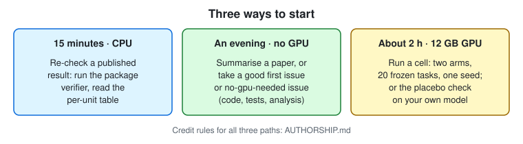

# Start here

This repository studies **experience memory for LLM agents that act**. The question: does showing an agent the *right* pieces of its earlier successful runs make it solve more tasks, and is it the match that helps, or just showing any text? Every step is compared on the same tasks with no memory and with a token-matched placebo block of the same length. The method is the [ladder in the README](README.md#how-we-work-the-ladder). The published numbers and their caveats are in [Current findings](README.md#current-findings).

This page covers your first hour: three ways to start, how credit works, and where things are. The repository changed course on 15 November 2026. Material from the earlier research lines is kept in the [archive section](#archive-earlier-research-lines) at the end of this page and in the [archive index](docs/ARCHIVE_INDEX.md).



## Three ways to start

### 1. Fifteen minutes on a CPU: check a published result

The latest published lab program is [ALFWORLD-LADDER-R4-V6](data/lab/autolab-alfworld-ladder-r4-v6/README.md) (n = 300 units).

1. Read its README, including the [caveats](data/lab/autolab-alfworld-ladder-r4-v6/README.md#caveats) and the [erratum](docs/11-research-laboratory/errata/2026-11-23-alfworld-ladder-r4-v6-seed1-and-d8-addendum.md).
2. Open the [per-unit table](data/lab/autolab-alfworld-ladder-r4-v6/per_unit.csv) next to it.
3. Recompute the published numbers from the package alone ([what the check covers](REPRODUCE.md#the-autolab-result-packages-recompute-the-published-numbers-from-the-package-alone)):

```bash
git clone https://github.com/krapcys1-maker/adaptive-agent-memory-research
cd adaptive-agent-memory-research
python -m pip install -r requirements-dev.txt   # one-time, about 230 MB
python scripts/verify_autolab_packages.py
```

**Done means** either the numbers match, or you open an issue naming the number, link or claim that does not hold. A reported problem in a published result is a real contribution. For more depth, use the [reproduction report template](.github/ISSUE_TEMPLATE/05-reproduction-report.md). For an example of a stored reanalysis, see [`data/contrib/`](data/contrib/2018cx-alfworld-ladder-r4-v5b-reanalysis/README.md).

### 2. An evening without a GPU: read, summarise, analyse

- **Summarise a paper.** See how existing notes are written in [full-read notes](docs/07-literature/full-read-notes/README.md), use the [claim template](docs/07-literature/claims/TEMPLATE.md), and pick a candidate from the [reading queue](docs/07-literature/reading-queue.md) or from the open questions in [DIRECTIONS.md](docs/research-map/DIRECTIONS.md) and [OPEN_PROBLEMS.md](docs/research-map/OPEN_PROBLEMS.md).
- **Code, tests, analysis.** Pick an issue labelled [`good first issue`](https://github.com/krapcys1-maker/adaptive-agent-memory-research/labels/good%20first%20issue), [`no-gpu-needed`](https://github.com/krapcys1-maker/adaptive-agent-memory-research/labels/no-gpu-needed) or [`no-expertise-needed`](https://github.com/krapcys1-maker/adaptive-agent-memory-research/labels/no-expertise-needed). Work for the current ladder is labelled [`ladder-v1`](https://github.com/krapcys1-maker/adaptive-agent-memory-research/labels/ladder-v1). Comment on the issue to claim it, so two people do not duplicate the work.
- **Before a pull request,** run `python tasks.py check` (every CI gate, about 5-6 minutes). Faster targets and the fork-and-PR flow are in [CONTRIBUTING.md](CONTRIBUTING.md) and the [first-contribution walkthrough](docs/00-project/first-contribution-walkthrough.md).

For every important research claim:

1. Link the primary source.
2. State what the source actually demonstrates.
3. Record limitations and competing interpretations.
4. Separate biological findings from proposed AI analogues.
5. Convert the analogue into a falsifiable hypothesis.
6. Define what evidence would reject the hypothesis.

### 3. About two hours on a 12 GB GPU: run a cell or the placebo check

- **A cell** is two arms on a block of 20 frozen tasks, with one seed, run on your own machine and submitted as a small pull request (a configuration card plus per-episode results). The protocol, including which jobs are open right now, is in [VOLUNTEER_COMPUTE.md](docs/research-map/VOLUNTEER_COMPUTE.md).
- **The placebo check** asks: does a meaningless block of the same length help *your* model too? What to run and what to submit: [placebo-check.md](docs/challenges/placebo-check.md). Accepted rows go into the [public results table](docs/challenges/RESULTS.md).
- To offer compute, use the [lend-a-GPU issue template](.github/ISSUE_TEMPLATE/07-lend-a-gpu.md), or look at issues labelled [`gpu-volunteer`](https://github.com/krapcys1-maker/adaptive-agent-memory-research/labels/gpu-volunteer).

## How credit works

The exact rules are in [AUTHORSHIP.md](AUTHORSHIP.md). In short: validated cells, merged substantive pull requests, and written reviews or replications count toward co-authorship of the next report. Smaller contributions are thanked by name. To cite the project, use [CITATION.cff](CITATION.cff). Pull requests are reviewed by the maintainer, [@krapcys1-maker](https://github.com/krapcys1-maker). Everyone is expected to follow the [Code of Conduct](CODE_OF_CONDUCT.md).

## Working in this repository

- Before substantial work, read [memory/CURRENT_STATE.md](memory/CURRENT_STATE.md). The full diagnostic history is in [memory/DIAGNOSTICS_ARCHIVE.md](memory/DIAGNOSTICS_ARCHIVE.md). Retrieve a focused context bundle through the project-memory MCP server or CLI; setup and usage are in [memory/README.md](memory/README.md).
- Where things are: [repository map](docs/00-project/REPOSITORY_MAP.md), [ROADMAP.md](ROADMAP.md), [laboratory map](docs/11-research-laboratory/lab-map.md). The lab map links every experiment README of the November writing-agent experiments, WMB, the memory kernel and LifeSim, and records executed checks, status and privacy limits.
- For the practical distinction between implemented tools, passing software tests and missing evidence about a complete agent, read [what exists and what is missing](docs/00-project/delivery-state-2026-11-04.md).

## Confidence vocabulary

- **Established:** supported by multiple strong sources or replicated evidence.
- **Supported:** credible evidence exists but scope or interpretation is limited.
- **Preliminary:** early result, preprint, or narrow experimental setting.
- **Hypothesis:** testable proposal without sufficient evidence yet.
- **Analogy:** conceptual mapping, not evidence of shared mechanism.
- **Speculation:** useful idea that is not yet operationalized.
- **Rejected:** contradicted, non-falsifiable, or empirically unhelpful.

## Archive: earlier research lines

Everything below describes the direction before 15 November 2026. It is kept unchanged in substance, with its results and negative findings. The current direction is the [ladder](README.md#how-we-work-the-ladder).

### What we were building toward

The desired future system has two boundaries:

```text
LLM context window
  = immediately available working set

User-owned disk
  = durable events, facts, decisions, skills, sources, and archives
```

A controller between them performs a lifecycle:

```text
observe -> encode -> write -> organize -> consolidate -> retrieve
        -> use -> evaluate utility -> revise/archive
```

This is not a claim that a context window is biologically identical to human working memory. It is an engineering analogy whose useful and misleading parts must be tested.

The accepted research floor is [Foundation v0](docs/04-systems/foundation-v0-architecture-decision.md): native or open compaction manages continuation, while an append-only local archive preserves future recoverability. Compaction, summaries, embeddings, graphs, salience, and learned memory policies are derived and replaceable; none owns the only copy of evidence.

### The first five questions

1. What is the atomic unit of agent memory: message, event, fact, relation, episode, procedure, or decision?
2. How can the system distinguish storage failure from retrieval failure and reasoning failure?
3. How can future utility be measured causally rather than inferred from retrieval frequency?
4. When should exact episodes be consolidated into semantic or procedural knowledge?
5. How can memories be updated without losing provenance, uncertainty, or superseded historical states?

### Previous reading path

1. [Scope and boundaries](docs/00-project/scope.md)
2. [Definitions](docs/00-project/definitions.md)
3. [Human memory research map](docs/01-human-memory/README.md)
4. [LLM memory research map](docs/02-llm-memory/README.md)
5. [Human-to-AI mapping](docs/03-human-ai-bridge/mapping.md)
6. [Systems catalog](docs/04-systems/catalog.md)
7. [Benchmark catalog](docs/05-benchmarks/catalog.md)
8. [Research methodology](docs/00-project/methodology.md)
9. [Comparative biological memory](docs/10-comparative-biological-memory/README.md)
10. [Research laboratory](docs/11-research-laboratory/README.md)
11. [Research-to-experiment gate](docs/11-research-laboratory/research-to-experiment-gate.md)
12. [Benchmark ladder](docs/11-research-laboratory/benchmark-ladder.md)
13. [Project Memory Lab v0](docs/11-research-laboratory/project-memory-lab-v0.md)
14. [Foundation v0 architecture decision](docs/04-systems/foundation-v0-architecture-decision.md)
15. [Foundation compaction plus memory benchmark](docs/11-research-laboratory/foundation-compaction-memory-benchmark-protocol-v0.md)
16. [Local dense and hybrid retrieval audit](docs/07-literature/local-dense-hybrid-retrieval-audit.md)
17. [Natural history retrieval benchmark v0](docs/11-research-laboratory/natural-history-retrieval-benchmark-protocol-v0.md)
18. [Natural completeness controller benchmark v0](docs/11-research-laboratory/natural-completeness-controller-benchmark-protocol-v0.md)
19. [Procedural memory retention and relearning benchmark v0](docs/11-research-laboratory/procedural-memory-retention-and-relearning-benchmark-protocol-v0.md)
20. [Tiered routing and future-utility audit](docs/07-literature/tiered-memory-routing-and-future-utility-audit.md)
21. [Memory-manager cascade benchmark v0](docs/11-research-laboratory/memory-manager-cascade-benchmark-protocol-v0.md)
22. [Future-utility telemetry protocol v0](docs/11-research-laboratory/future-utility-telemetry-protocol-v0.md)
23. [Interdisciplinary memory mechanisms](docs/12-interdisciplinary-memory/README.md)
24. [Cross-disciplinary hypothesis portfolio](docs/12-interdisciplinary-memory/hypothesis-portfolio.md)
