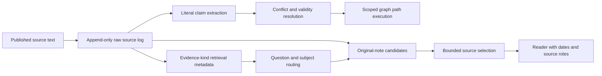

# Source-grounded runtime: implemented contracts and integration boundary

This engineering candidate provides persistent source capture, literal-grounded
derivations and two read paths. It does not replace the frozen WMB kernels or
declare the project's final adaptive architecture. See the
[executed development evidence](../../data/lab/structured-memory-v1/README.md)
and the separate H1 amendments, including failed variants.



## Library entry points

| Module | Implemented responsibility |
|---|---|
| `tools/structured_memory_v1.py` | Raw source/extraction log, grounding, explicit state/source contracts, graph execution |
| `tools/structured_memory_v2.py` | Informative literal-shell cache and most-specific matching |
| `tools/retrieval_metadata_v1.py` | Evidence addresses for facts, instructions, procedures, rationales, observations and questions |
| `tools/retrieval_metadata_v2.py` | Case-insensitive lookup grounded back to the actual whole source span |
| `tools/evidence_memory_v1.py` | Persistent metadata attachments, explicit revisions and scoped/time-bounded source recall |
| `tools/evidence_candidates_v1.py` | Bounded source-first recovery including metadata-rejected raw notes |

The scripts under `scripts/h1_*` and `scripts/structured_memory_*` are versioned
research controllers. Their process-local hooks select declared experiment
versions; they are not production agent configuration. Integrations should use
the library interfaces and a separately owned model adapter.

## Persistence and scope

A `Source` contains stable `id`, authorized `scope`, exact `text`, integer
`recorded`, optional `valid_from` and exclusive `valid_to`, explicit source
policy and optional superseded source IDs. The caller declares the time unit.
Raw text is saved before extraction and survives a failed derivation. Identity
collisions cannot overwrite it. Torn/corrupt logs stop loading rather than
silently deleting data. The SQLite project-memory tool and this candidate have
separate logs and purposes.

The caller chooses the authorized scope; this library filters it and does not
implement account authentication. It must not let the model broaden a scope or
invent a source role. Derive `user_message`, `agent_note`, `tool_result` or
`unknown` from the publisher channel. Fictional journal records need a distinct
fiction/profile scope; retrieval does not turn them into real biography.

## Truth and evidence metadata

Graph claims require literal subject/object spans and bounded predicates.
Generic sources retain conflicts. `ordered_single` is an explicit adapter
contract used by FactConsolidation, not a default for arbitrary conversations.
Recording/availability time and effective time differ. An effective future
claim cannot mask an earlier value before it starts. An expired winning state
does not silently revive its predecessor. Multi-valued and ambiguous relations
remain unresolved where the candidate cannot justify a single value.

Retrieval addresses are different: they say which subject/property/kind a note
concerns. They can index a command or a question without asserting that command
as a fact or granting authority to execute it. The original role, text and date
are still needed. `EvidenceMemory.recall` returns source history, not a claim
that its newest note is automatically true. No lookup writes a missing fact.

Metadata attachments carry a raw-source hash and caller-provided provenance.
Changing an attachment requires its exact superseded attachment ID; old entries
remain in the log. Source and metadata writers share an exclusive raw-log lock.
Readers detect mismatched/corrupt metadata and do not repair it automatically.

## Minimal executable use

First publish a source through `tools/structured_memory_cli_v1.py source`. Obtain
the model's actual proposal from the declared backend and retain that response's
provenance. Attach retrieval metadata and recall it:

```bash
python tools/evidence_memory_v1.py --raw /state/sources.jsonl --metadata /state/addresses.jsonl attach --source note-1 --proposal /state/model-proposal.json --source-role agent_note --provenance local-response-request-sha256
python tools/evidence_memory_v1.py --raw /state/sources.jsonl --metadata /state/addresses.jsonl recall --scope fiction-profile --entity Nera --property workspace --known-at 30
```

An address proposal has this shape; its entity must occur in the source:

```json
{"addresses":[{"entity":"Nera","property":"workspace","kind":"fact"}]}
```

The source-first controller demonstrates recovery from derived-index failures.
It never discards raw notes because extraction was empty or quarantined. It
offers complete source notes to a bounded reranker, validates selected IDs, and
passes at most three notes to the reader. Candidate context and inference cost
are additional and must be reported; they are not hidden by quoting only the
final reader's context size.

## What is still required

Production publication hooks, automatic time/provenance interpretation,
nonliteral aliases/coreference, learned retention utility, broad independent
transfer and deployment are not established. H1, already-spent MAB questions and
authored canaries are development evidence. Semantic extraction correctness is
not proven by literal-span or artifact replay checks. Preserve old negatives and
do not promote an independence tier from a neighbouring experiment.

NIE already has its own history/shadow paths. This candidate does not change its
personality, prompts, improvisation/write-back policy or deployed server. A
separate integration must honor the existing publisher/ownership contract.
