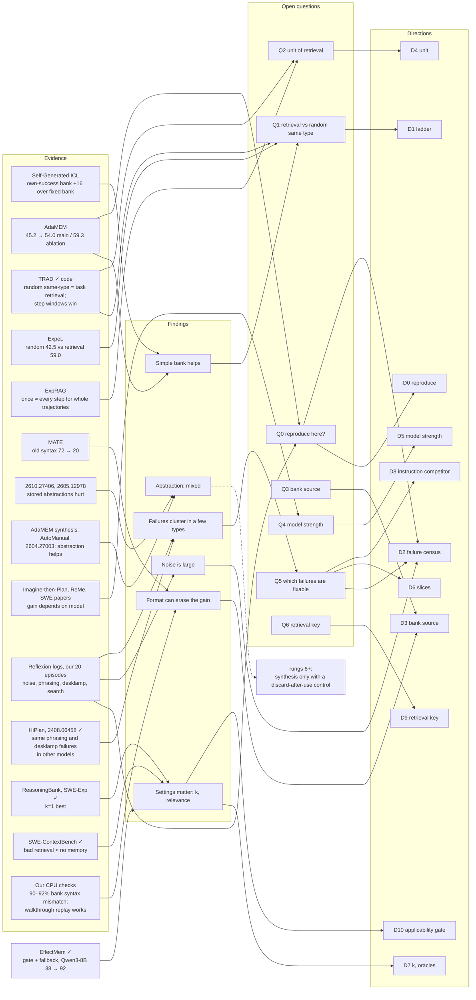

# Map of connections: evidence → findings → open questions → directions

This page links what is known to what is open and to what could be done about it. It is a **map, not a plan**: the laboratory and contributors are free to follow other paths, merge directions, or draw different conclusions from the same evidence. Each direction's details are in [DIRECTIONS.md](DIRECTIONS.md), and the sources with their verification levels are in [README.md](README.md).

## 1. The map

Solid arrows mean "supports" or "raises". The dotted arrow is a later option, not a current direction. ✓ marks numbers that we spot-checked in the source.

## 2. Where the threads cross

These are the places where one result would change several plans. They are the most informative experiments per GPU hour.

**Q0 meets Q5: one run answers both.**
- A no-memory run on all 140 `valid_seen` tasks (D2) gives the noise floor and the failure census. It also settles Q0: is our 60–70% on 20 tasks an easy sample, or a harness difference?
- If 14 of 20 came from a true rate of 45.2%, that would happen by chance only about 2% of the time (binomial). So the gap is worth explaining before any memory arm.

**Q1 meets Q5 and D8: is memory needed where it seems to help?**
- In other models too, the dominant failures are a skipped transform in adjective-form goals, the desklamp order and object substitution (HiPlan; 2408.06458 with Gemma-2-9B; our 20 episodes).
- A random same-type example (rung 3) or a single instruction (D8) might fix them.
- If either does, retrieval by similarity must show its value elsewhere, probably on search (Q3, D3).

**Q2 meets Q6: what to retrieve, and with what key.** The evidence on keys:
- TRAD retrieves by the agent's thought;
- Self-Generated ICL uses the reasoning after the first step;
- R2A found that a raw-state query gave no gain;
- ReMe found a model-written "usage scenario" key beats the raw task description (BFCL-V3, figure only);
- AdaMEM retrieves by the current state.

Unit and key are usually changed together. Separating them is cheap, because both run off the same bank and the same CPU embeddings.

**Q3 meets F2: the bank source decides what format problems exist.**
- Walkthroughs and the agent's own runs are in the current syntax by construction.
- Public banks need translation and a replay check (#178).
- Walkthroughs never search, and the agent's own runs do.

**Q4 meets the second benchmark.**
- The gain from memory depends on the model, and the evidence comes from several benchmarks: on ALFWorld (Imagine-then-Plan), RAP adds +9.3 for Qwen3-8B and +1.4 for Llama-3.1-8B; on AppWorld (ReMe ✓), Qwen3-8B goes from 14.97 to 24.70 with ReMe while A-Mem and LangMem fall below no memory.
- So a second benchmark should be run with at least two models, not one.

## 3. Decision points (open, not prescribed)

The table gives examples of how a result could re-route the work. The laboratory may choose differently and should record why.

| If… | …then one reasonable reading is | Options that open up |
|---|---|---|
| D0 does not reproduce AdaMEM's gain | the published gain depends on settings we do not share | inspect the harness differences first; D2; a smaller ladder |
| D2 shows most failures are phrasing or desklamp | memory may act mostly as a procedure reminder | D8 (instruction) against rung 3; D6 slices; D3 with walkthroughs |
| D2 shows most failures are search | the bank must show *where to look* | D3 with the agent's own runs; D4 windows; D9 keys |
| Rung 3 ≈ rung 4 within the equivalence margin | similarity adds nothing over the same type, as in TRAD with GPT-4 | D4 and D9 (unit and key) rather than better similarity |
| Rung 5 > rung 4, but not against the intermediate arm | the gain is the refresh, not the step unit | D4 with matched refresh |
| The weaker model gains more (D5) | supports the ExpeL-versus-TRAD reading | prioritise small models; widen D5 |
| The best oracle arm (D7) is far above every rung | retrieval, not the bank, is the bottleneck | D9, a k sweep, abstain thresholds |
| The best oracle is close to rung 5 | the bank's content is the limit | D3 (a different source), a larger or curated bank |
| An effect seen on `valid_seen` shrinks on `valid_unseen` | a train bank leaked scene knowledge (pre-registered expectation) | report both; ScienceWorld or AppWorld next |

## 4. What stays fixed, and what the laboratory may decide

**Invariants.** These keep results comparable and honest:
- `valid_unseen` is untouched until one confirmation;
- banks come from `train` only;
- frozen task lists, with their SHA-256;
- the same step limit and the same retrieved-text budget across arms;
- decision rules and families written down before each run;
- raw runs frozen;
- the paired test of DIRECTIONS section 6;
- negative results are published as results.

**Free for the laboratory:**
- which directions to run, in what order, and whether to merge them;
- new arms or new directions not on this page;
- the choice of keys, units, k, thresholds and models within the hardware;
- a different second benchmark;
- re-interpreting the evidence, with reasons.

When the laboratory departs from this map, it records the reason. That record is part of the result.

## 5. Leads not yet followed

These came up but were not read in depth.

- **Games with computable optimal moves** as a fresh benchmark for experience memory: PlyBench (2608.03420; tic-tac-toe, Nim, Connect Four, with obfuscated variants). Outcomes need no judge, and per-move credit is computable.
- **EffectMem** (EMNLP 2026 Findings): now read; see direction D10. Its large single-seed gains come from a whole pipeline, so the gate's own share is open.
- **AppWorld with Qwen3-8B and ReMe** (2512.10696 ✓): a local-model memory result on a tool-use benchmark, Apache-2.0. A natural candidate for Stage 3 of the ROADMAP.
- **The relabeling of failed trajectories as successes for other goals** (HSL, 2607.04235, ICLR 2026): used there only for fine-tuning a 1B model. Whether relabeled runs work as in-context examples, and how often a failed ALFWorld run satisfies another goal, are both unmeasured. It is a cheap way to grow a bank, with a leakage risk if test goals are used.
- **ScienceWorld as the second benchmark:** see DIRECTIONS section 4a. Three studies show raw-trajectory gains there.
